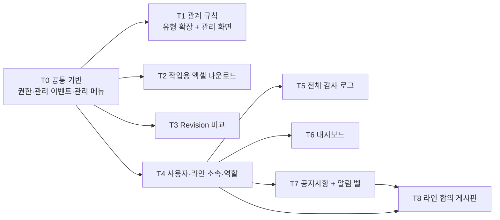

# Phase 7 — 관리·운영 기능 (작업 계획)

> 목표: 재구축 전 레거시에 있었고 아직 이식하지 않은 관리·운영 기능을 현재 구조(동적 레지스트리, snapshot v3, SSO 경계, change_event 이력) 위에 다시 세운다. **재배포 없이 제약을 관리**하고, **라인 간 합의를 사이트 안에서 운영**하며, 공지·대시보드·사용자·감사 로그로 일상 운영을 지원한다.

관련 문서: [04-roadmap.md](./04-roadmap.md) Phase 7 · [phase-3-tasks.md](./phase-3-tasks.md) (검증 엔진) · [phase-5-tasks.md](./phase-5-tasks.md) (승인·Revision·RBAC) · [docs/phase-5-d10-sso-rbac.md](../docs/phase-5-d10-sso-rbac.md) (SSO 경계)

선행 조건: Phase 5 완료. Phase 6(전산 출력)과 독립이며 먼저 진행할 수 있다.

## 이 문서를 읽는 법 (사내 구현용)

- 구현은 사내에서 진행한다. 이 문서만으로 착수할 수 있도록 **현재 코드의 실제 경로와 패턴**을 적었다. 기준 시점은 커밋 `6f4f874`(main `2026105` + Phase 7 로드맵)이다. 경로가 바뀌었으면 같은 역할의 파일을 찾는다.
- 레거시 구현은 커밋 `2f71a4e`(로컬 태그 `pre-rebuild-snapshot`, 원격에는 태그가 없음)에 남아 있다. `git show 2f71a4e:<경로>`로 열람한다. **레거시 코드를 옮겨 붙이지 않는다.** 화면 구성과 업무 흐름의 참고용으로만 쓴다.
- "(신규)"는 새로 만드는 파일, 표시가 없는 경로는 이미 있는 파일이다.
- 결정 항목 중 "권고"만 있고 확정되지 않은 것은 **권고안을 기본값으로 착수**하되, 해당 작업 완료 전에 확정 기록을 남긴다.

## 완료 기준 (Exit Criteria)

- [ ] EC1. 관리자가 재배포 없이 화면에서 관계 규칙 5종(기존 2 + 신규 3)을 생성·수정·비활성화하고, 시트에서 즉시(클라이언트) 및 저장 후(서버) 같은 결과로 검증된다. 기존 승인본의 snapshot digest는 바뀌지 않는다
- [ ] EC2. 어떤 상태의 조건표든 작업용 엑셀(.xlsx)로 내려받을 수 있다. Approved/Archived는 승인 시점 스냅샷 컬럼으로 출력되고, 수식 주입이 차단된다
- [ ] EC3. 같은 제품의 임의의 두 Revision 차이를 요약 통계와 layer → 조건 행 → 셀 drill-down으로 볼 수 있다
- [ ] EC4. SSO 첫 로그인 사용자가 자동 등록되고, 관리자가 역할·라인 소속·라인 대표를 지정한다. 비활성 사용자는 업무 API가 거부되고, 자기 강등·마지막 관리자 제거가 차단된다
- [ ] EC5. 전 프로젝트 이벤트와 관리 이벤트(레지스트리·사용자·공지·합의 변경)를 필터로 조회하고 사용자 이름으로 표시한다. 관리 이벤트는 변경과 같은 트랜잭션에서 기록된다
- [ ] EC6. 대시보드에서 상태별 건수, 내 최근 작업, 검토 대기, 최근 상태 변경, 알림 요약을 본다
- [ ] EC7. 공지를 작성·수정·삭제하고 사용자별 읽음 상태와 알림 벨이 동작한다. 이미지 업로드는 형식·크기 검증을 거치고, 본문 렌더링은 XSS에 안전하다
- [ ] EC8. 라인 합의 요청이 작성 → 라인 대표 투표 → 관리자 결정 → 반영 중 → 완료(또는 취소)까지 진행되고, 투표 대기 알림과 전체 이력이 남는다
- [ ] EC9. 품질 게이트를 통과한다. 백엔드 `ruff`·`pyright`·`pytest`(PostgreSQL 포함), 프론트 `typecheck`·`lint`·`test`·`build`, 권한 매트릭스 테스트 갱신, 1024/1440/1920 브라우저 QA

## 결정 항목

### 확정 (2026-11-24)

| # | 항목 | 결정 |
|---|------|------|
| P7-D1 | 역할 소스 | PCM 화면에서도 역할을 부여한다. P5-D1의 "IdP 그룹이 유일한 역할 소스, 로컬 사용자/역할 테이블 없음"을 이 Phase에서 변경한다. 로컬 사용자는 SSO 첫 로그인 시 생성 |
| P7-D2 | 합의 규칙 | 라인당 1표(라인 대표 투표). 투표는 참고 의견이며 관리자가 최종 승인·반려 |
| P7-D3 | 설비 그룹 키 | 적재 데이터의 `eqp_type`(`sheet_layer.eqp_type`). 개별 설비가 아니라 설비 유형 단위 |

### 확정 필요 (권고안으로 착수)

| # | 항목 | 권고 | 필요 시점 |
|---|------|------|----------|
| P7-D1a | IdP 역할과 PCM 역할의 결합 | **합집합**(유효 역할 = IdP 그룹 역할 ∪ PCM 부여 역할). IdP 출처 역할은 화면에서 읽기 전용으로 표시. PCM `is_active=false`는 모든 역할보다 우선(업무 API 전면 거부). 자기 자신의 admin 제거·비활성화 금지, 유효 admin이 1명 남으면 그 사람의 admin 제거·비활성화 금지 | T4 착수 전 |
| P7-D2a | 라인 대표 운영 | 대표는 관리자가 지정(라인당 최대 1명). 대표 미지정 라인은 "대표 미지정"으로 표시하고 집계에서 제외(관리자 최종 결정이므로 진행 가능). 합의는 **기록만** 남기고 레지스트리 변경을 막지 않는다. 완료 처리 시 관련 관리 이벤트(T5)를 연결 | T8 착수 전 |
| P7-D4 | 신규 규칙 유형과 snapshot v3 | `SNAPSHOT_VERSION = 3` 유지. 규칙 spec의 판별 유니온만 확장한다. 기존 승인본에는 신규 유형이 없으므로 digest가 바뀌지 않음을 회귀 테스트로 고정 | T1 |
| P7-D5 | 레이어 간 비교의 참조 layer 지정 | 행의 **참조 컬럼 값**(예: `OVL Target`)과 앞선 layer들의 POR 행 **Layer 명 컬럼** 값을 매칭해서 찾는다(레거시 방식, P3-D5의 POR 기준과 일치) | T1 |
| P7-D6 | 엑셀 값 표기 | 셀 값은 저장값 그대로(선택지는 code, 숫자는 정밀도 보존을 위해 텍스트). 헤더는 2행(1행 표시명+단위, 2행 parameter code)이라 다시 붙여넣을 때 매핑할 수 있다. 선택지 label 열 추가는 요청 시 | T2 |
| P7-D7 | 게시판 본문 형식 | Markdown 입력 + 미리보기 + 이미지 붙여넣기 업로드. WYSIWYG 에디터는 도입하지 않는다(폐쇄망 반입·보안 검토 부담) | T7 |
| P7-D8 | 반입 항목 | 백엔드 `openpyxl`(T2, Phase 6에서도 재사용), 프론트 `dompurify`(T7), 업로드 저장 볼륨(`UPLOAD_DIR`, 백업 대상 포함). 사내 미러·인프라 반입 승인 필요 | T2·T7 착수 전 |
| P7-D9 | 첫 화면 | 대시보드를 첫 화면(`/`)으로. 제품 목록은 내비게이션 첫 항목 유지 | T6 |
| P7-D10 | 신규 권한 배정 | 아래 "공통 규칙 > 권한" 표 | T0 |

## 작업 분해 (Work Breakdown)



| 작업 | 선행 | 병행 가능 |
|------|------|----------|
| T0 공통 기반 | — | — |
| T1 관계 규칙 | T0 | T2, T3, T4 |
| T2 엑셀 다운로드 | T0 | T1, T3, T4 |
| T3 Revision 비교 | T0 | T1, T2, T4 |
| T4 사용자 | T0 | T1, T2, T3 |
| T5 감사 로그 | T4 (이름 표시) | T6, T7 |
| T6 대시보드 | T4 | T5, T7 |
| T7 공지사항 | T4 (읽음 사용자) | T5, T6 |
| T8 합의 게시판 | T4, T7 (에디터·업로드·알림 벨) | — |

마일스톤 권고: **M1** T0+T1 (재배포 없는 제약 관리) → **M2** T2+T3 → **M3** T4+T5+T6 → **M4** T7+T8

---

## 공통 규칙

### 코드 구조

- 백엔드 기능은 `backend/app/features/<기능>/`에 `router.py`·`service.py`·`repository.py`·`schema.py`로 둔다(예: `features/approval/`). 라우터는 `backend/app/main.py`의 `api_router.include_router(...)`에 등록한다(prefix `/api`).
- 순수 도메인 로직(판정·비교·검증)은 `backend/app/domain/<영역>/`에 FastAPI·SQLAlchemy 없이 둔다. 단위 테스트는 DB 없이 돈다(Phase 3 EC3 원칙).
- ORM 모델은 `backend/app/models/`, 마이그레이션은 `backend/alembic/versions/`에 `0010_...`부터 작업당 1개 이상으로 추가한다.
- 프론트 API 클라이언트는 `frontend/src/api/<기능>.ts`(axios `client.ts` + TanStack Query), 화면은 `frontend/src/features/<기능>/`, 공용 컴포넌트는 `frontend/src/shared/components/`, 라우트는 `frontend/src/app/routes.tsx`, 내비게이션은 `frontend/src/shared/layout/AppLayout.tsx`.
- 사용자에게 보이는 문구는 한국어로 "문제 + 영향 + 다음 행동" 순서(PRODUCT.md)를 따른다. 내부 code·정규식·영문 판정문을 노출하지 않는다.

### 마이그레이션

- **추가형만 허용**한다. 운영 데이터가 있으므로 `0004` 같은 reset-only 전환을 만들지 않는다. 컬럼 추가는 nullable 또는 server default로 한다.
- `change_event`처럼 큰 테이블의 인덱스는 `0007_history_query_indexes.py`의 `CREATE INDEX CONCURRENTLY` 헬퍼 패턴을 따른다.

### 권한 (P7-D10 권고)

`backend/app/core/auth.py`의 `Permission`에 추가하고 `_permissions_for_roles`에 배정한다. `require_<권한>` 의존성 함수도 기존 `require_registry_manage` 형식으로 추가한다.

| 권한 (신규) | 용도 | admin | reviewer | editor |
|---|---|:-:|:-:|:-:|
| `user.manage` | 사용자 상태·역할·라인 소속·대표 지정 | ✅ | | |
| `audit.read` | 전체 감사 로그 조회 | ✅ | ✅ | |
| `announcement.manage` | 공지 작성·수정·삭제 | ✅ | | |
| `consensus.decide` | 합의 요청 승인·반려·반영 시작·완료 | ✅ | | |

- 합의 요청 작성·댓글은 `business.read`가 있는 모든 사용자, 투표는 **해당 라인 대표**만 할 수 있다. 투표는 권한이 아니라 데이터(`user_line.is_representative`)로 판정한다.
- 프론트 `frontend/src/api/auth.ts`의 `AuthPermissions`에 `canManageRegistry`, `canManageUsers`, `canReadAudit`, `canManageAnnouncements`, `canDecideConsensus`를 추가하고 메뉴·버튼 노출을 제어한다. 서버 권한 검사가 진짜 경계이고, 화면 숨김은 편의다.
- Phase 5 권한 매트릭스 테스트(`backend/tests/test_auth.py`, `backend/tests/features/test_phase5_adversarial_contracts.py`)에 신규 권한의 허용·거부를 추가한다.

### 동시성·보안 공통

- 관리 데이터(규칙·공지·합의 요청) 수정은 `expected_version` 낙관적 잠금을 쓴다(현재 `ValidationRulePatchIn` 패턴). 버전이 다르면 409를 반환하고, 화면은 "다른 사용자가 먼저 수정했습니다. 새로 불러온 뒤 다시 저장해 주세요."로 안내한다.
- 목록 API는 cursor 페이지네이션(id 내림차순)을 쓰고 `limit` 상한은 200으로 한다(현재 `list_projects` 패턴).
- 모든 신규 엔드포인트는 `get_current_user` 인증과 권한 의존성을 라우터 단에서 선언한다.

### 테스트·게이트 명령

```bash
cd backend && uv run ruff check . && uv run pyright && uv run pytest
```

```bash
cd frontend && npm run typecheck && npm run lint && npm test -- --run && npm run build
```

- PostgreSQL이 필요한 테스트(`*_pg.py`, `tests/migrations/`)는 `APP_TEST_DATABASE_URL`이 있을 때 실행된다. CI(`.github/workflows/ci.yml`)는 PostgreSQL을 띄워 전체를 돈다.
- 브라우저 QA는 `scripts/qa/`의 Playwright 스크립트 패턴을 따르고, 근거는 `docs/evidence/phase-7-<작업>/`에 남긴다.

---

## T0. 공통 기반

목적: 이후 작업이 공유할 권한, 관리 이벤트 기록, 관리 메뉴 틀을 먼저 만든다.

**백엔드**

- 권한 4종 추가(위 표). `/api/auth/me` 응답에 자동 포함되는지 확인한다(`features/auth/router.py`).
- 관리 이벤트 테이블 `admin_event`(신규, `backend/app/models/audit.py`). `change_event`는 `project_id`가 필수라 레지스트리·사용자 변경을 담을 수 없으므로 별도로 둔다.

  | 컬럼 | 타입 | 설명 |
  |---|---|---|
  | id | bigint PK | |
  | entity_type | varchar(32) | `parameter`, `parameter_category`, `choice_set`, `choice_option`, `validation_rule`, `user`, `announcement`, `consensus_request` |
  | entity_key | varchar(128) | 대상 code 또는 id |
  | action | varchar(32) | `create`, `update`, `activate`, `deactivate`, `delete`, `role_change`, `line_change`, `vote`, `decide`, `status_change`, `csv_import` |
  | actor | varchar(128) | `UserContext.id` (change_event.actor와 같은 체계) |
  | before | jsonb null | 변경 전 값 중 **바뀐 필드만** |
  | after | jsonb null | 변경 후 값 중 바뀐 필드만 |
  | batch_id | varchar(64) null | CSV 가져오기처럼 한 번에 여러 건 바뀐 묶음 |
  | created_at | timestamptz | server default now() |

  인덱스: `(id desc)`, `(entity_type, entity_key, id desc)`, `(actor, id desc)`.
- 기록 헬퍼 `record_admin_event(session, *, entity_type, entity_key, action, actor, before, after, batch_id=None)`(신규, `backend/app/features/audit/writer.py`). **호출 측 트랜잭션 안에서** insert만 한다. 커밋은 호출 측이 한다.

**프론트엔드**

- `AppLayout.tsx` 내비게이션에 권한별 "관리" 그룹 틀을 만든다(항목은 각 작업에서 채움).
- `AuthPermissions` 플래그 5종 추가(위 권한 절).

**테스트**: 권한 매트릭스 확장, `record_admin_event`가 롤백 시 함께 사라지는지(같은 트랜잭션) PG 테스트.

산출물: 권한·`admin_event`·기록 헬퍼·관리 메뉴 틀.

---

## T1. 관계 규칙 유형 확장 + 관리 화면

목적: "재배포 없이 신규 제약 생성·수정·삭제". Phase 3에서 만든 규칙 엔진·API(`/api/validation-rules`) 위에 신규 유형 3종과 관리자 화면을 얹는다(P3-D18에서 보류한 rule-builder UI).

### T1-1. 현재 상태

- 유형 2종이 있다. `required_if`(A 컬럼 = a이면 B 컬럼이 비어 있으면 안 됨)와 `value_exists_in_prior_por`(이 컬럼 값이 앞선 layer들의 POR 행 특정 컬럼 값 중 하나여야 함).
- **"OVL Target 값은 앞선 Layer 명 중 하나"는 신규 개발 없이 기존 `value_exists_in_prior_por`로 등록한다.** `source_parameter_code = OVL Target 컬럼`, `candidate_parameter_code = Layer 명 컬럼`. 이 규칙은 앞선 layer의 **POR 행**만 후보로 본다.
- API는 `POST/GET/PATCH /api/validation-rules`(쓰기는 `registry.manage`). 하드 삭제는 없고 `is_active=false`로 비활성화한다. 승인본은 승인 당시 규칙이 snapshot에 동결돼 영향을 받지 않는다.

### T1-2. 신규 규칙 유형

모든 신규 spec은 `schema_version: 1`로 시작한다. 숫자 비교는 기존 decimal 정규화(`app/domain/decimal_values.py`)를 쓰고, 선택지 값은 code로 비교한다.

**(a) `allowed_values_if` — 같은 행 조건부 값** ("1번 컬럼이 A이면 2번 컬럼은 B여야 한다")

```json
{
  "schema_version": 1,
  "type": "allowed_values_if",
  "when_parameter_code": "process_mode",
  "equals": "A",
  "target_parameter_code": "recipe_type",
  "allowed_values": ["B"]
}
```

- 같은 조건 행에서 `when` 값이 `equals`와 같으면, `target` 값이 `allowed_values` 중 하나여야 한다. `allowed_values`는 1~50개, 중복 불가, target 타입 기준으로 정규화한다. 선택지 타입이면 해당 ChoiceSet의 code여야 한다(등록 시 검증, `required_if`의 리터럴 검증과 같은 방식).
- target이 **비어 있어도 위반**이다("B여야 한다"이므로).
- 이슈 code `value_not_allowed_if`, details: `when_parameter_code`, `equals`, `target_parameter_code`, `allowed_values`.
- 문구: `{when 표시명}가 {equals}이면 {target 표시명}은 {허용값을 '또는'으로 연결}이어야 합니다.`

**(b) `compare_with_reference_layer` — 레이어 간 값 비교** (P7-D5)

```json
{
  "schema_version": 1,
  "type": "compare_with_reference_layer",
  "reference_parameter_code": "ovl_target",
  "layer_name_parameter_code": "layer_name",
  "left_parameter_code": "ovl_spec",
  "operator": "lte",
  "right_parameter_code": "ovl_spec"
}
```

- 이 행의 `reference_parameter_code` 값으로, **앞선 layer들의 POR 행** 중 `layer_name_parameter_code` 값이 같은 행을 찾는다. 여러 개면 **가장 가까운 앞선 layer**를 쓴다.
- 찾은 행의 `right` 값과 이 행의 `left` 값을 `operator`로 비교한다. `lt`·`lte`·`gt`·`gte`는 두 컬럼 모두 숫자 타입이어야 하고, `eq`·`ne`는 같은 타입이어야 한다(선택지면 같은 ChoiceSet). 등록 시 검증한다.
- 참조 값이 비었거나 참조 layer를 못 찾으면 **이슈를 내지 않는다**. 존재 여부는 (a)가 아니라 `value_exists_in_prior_por` 규칙으로 따로 건다. left나 right가 비어도 이슈를 내지 않는다.
- 이슈 code `layer_comparison_failed`, details: `left_parameter_code`, `operator`, `right_parameter_code`, `reference_value`, `reference_layer_key`, `right_value`.
- 문구: `{left 표시명}은 참조 레이어 {reference_value}의 {right 표시명}({right_value}) {이하/이상/미만/초과/와 같아야/와 달라야} 합니다.`

**(c) `eqp_type_group_consistency` — 같은 설비 유형 layer 간 일치·허용 오차** (P7-D3)

```json
{
  "schema_version": 1,
  "type": "eqp_type_group_consistency",
  "parameter_code": "focus_offset",
  "mode": "within_tolerance",
  "tolerance": "0.05"
}
```

- 규칙 scope 안의 layer를 `sheet_layer.eqp_type`(null 제외)으로 묶고, 각 layer의 **POR 행** 값을 모은다. 빈 값은 제외하고, 값이 2개 미만인 그룹은 건너뛴다.
- `same_value`: 그룹 안의 값이 모두 같아야 한다. `within_tolerance`: `max - min <= tolerance`. `tolerance`는 `within_tolerance`에서만 필수이고 0보다 커야 하며, 컬럼은 숫자 타입이어야 한다.
- 위반 그룹의 **비어 있지 않은 모든 POR 셀**에 이슈를 단다. 이슈 code `eqp_type_group_inconsistent`, details: `eqp_type`, `mode`, `tolerance`, `min_value`, `max_value`, `distinct_value_count`.
- 문구(same_value): `같은 설비 유형({eqp_type}) 레이어끼리 {param 표시명} 값이 같아야 합니다. 지금은 {n}가지 값이 있습니다.`
- 문구(within_tolerance): `같은 설비 유형({eqp_type}) 레이어 사이의 {param 표시명} 차이는 {tolerance} 이하여야 합니다. 지금은 {min}~{max}입니다.`

### T1-3. 수정 지점 (신규 유형 추가 시 전부 손대야 함)

백엔드:

| 파일 | 작업 |
|---|---|
| `backend/app/domain/validation/types.py` | `ValidationRuleType`에 3종 추가, spec dataclass 3개 추가, `ValidationRuleSpec` 유니온 확장 |
| `backend/app/domain/validation/evaluator.py` | `_evaluate_<유형>` 3개 추가, `evaluate_project`의 분기에 연결(현재 `_evaluate_required_if`·`_evaluate_prior_por` 패턴) |
| `backend/app/domain/validation/hashing.py` | `_canonical_rule` 분기에 3종 추가. basis hash에 들어가는 정규형을 정의 |
| `backend/app/domain/parameters/definition_view.py` | snapshot에서 규칙을 읽는 분기(현재 `required_if`/`value_exists_in_prior_por`)에 3종 추가 |
| `backend/app/domain/parameters/snapshot.py` | `_validation_rule_out`이 신규 spec을 그대로 직렬화하는지 확인 |
| `backend/app/features/validation/schema.py` | `...SpecIn` 3개 추가, `ValidationRuleSpecIn` 판별 유니온 확장(`extra="forbid"`, `schema_version`은 정수 1만 허용 패턴 유지) |
| `backend/app/features/validation/rule_service.py` | 참조 parameter 존재·타입·ChoiceSet code 검증과 정규화(`_canonical_required_if` 패턴) |
| `backend/app/features/validation/project_service.py` | `_ISSUE_DETAIL_KEYS`에 신규 이슈 code 3종과 details 키 등록 |

프론트엔드(클라이언트 즉시 검증이 서버와 같은 결과를 내야 함):

| 파일 | 작업 |
|---|---|
| `frontend/src/api/types.ts` | 규칙 spec 타입 3종 추가 |
| `frontend/src/shared/domain/validation/types.ts` | `ValidationRuleType`, spec, 이슈 details 타입 추가 |
| `frontend/src/shared/domain/validation/evaluator.ts` | 서버와 같은 판정 로직 3종 |
| `frontend/src/shared/domain/validation/messages.ts` | 위 한국어 문구 |
| `frontend/src/features/sheets/validationWorkbenchState.ts` | 관계 이슈 code 목록에 3종 추가 |
| `frontend/src/shared/domain/validation/golden-cases.json` | 3종 각각 통과·위반·경계(빈 값, 참조 없음, 허용 오차 경계값) 케이스. 백엔드 `backend/tests/domain/validation/test_golden_contract.py`가 같은 파일로 서버 결과를 대조 |

### T1-4. snapshot·basis 호환 (P7-D4)

- `SNAPSHOT_VERSION`은 3으로 유지한다. 기존 승인본에는 신규 유형이 없으므로 digest가 바뀌지 않아야 한다. 기존 snapshot fixture의 digest가 그대로인지 확인하는 회귀 테스트를 `backend/tests/domain/test_parameter_snapshot.py`에 추가한다.
- 신규 유형 규칙이 있는 Draft를 승인하면 snapshot에 신규 spec이 동결되고, 이후 규칙을 수정·비활성화해도 승인본 검증 결과가 바뀌지 않음을 API 테스트로 고정한다(Phase 5 EC1 테스트 확장).

### T1-5. 관리 화면

- 경로 `/parameters/rules`(신규). 파라미터 영역 섹션 내비게이션(`frontend/src/features/choiceSets/ParameterSectionNav.tsx`, 현재 파라미터·ChoiceSet 전환)에 "관계 규칙" 항목을 추가한다.
- 파일(신규): `frontend/src/api/validationRules.ts`, `frontend/src/features/validationRules/ValidationRuleListPage.tsx`, `ValidationRuleDrawer.tsx`, `ruleForm.ts`(폼 상태·검증 순수 함수), 각 테스트.
- 목록: code, 이름, 유형(한국어 라벨), 심각도(오류/경고), 적용 범위 요약, 버전, 활성 여부. 유형·활성·검색 필터.
- 작성·수정 drawer(기존 drawer/dialog 접근성 계약과 `ModalSurface` 사용):
  - 유형 선택 → 유형별 필드. parameter 선택은 `SearchableChoice`. `equals`·`allowed_values`는 대상이 선택지 타입이면 해당 ChoiceSet 옵션에서 고르고, 아니면 텍스트 입력.
  - 적용 범위: 라인(`GET /api/projects/lines`), process, layer_id, step_seq, eqp_type, area_name. 비우면 전체.
  - 저장 전 문장 미리보기: 예) "공정 모드가 A이면 레시피 유형은 B여야 합니다."
  - 안내 문구: "저장하면 작성 중(Draft) 조건표에 바로 적용됩니다. 승인된 조건표는 승인 당시 규칙을 유지합니다."
  - `expected_version` 409 처리. code는 생성 후 변경 불가(현재 API 계약).
- 비활성화·재활성화는 목록에서 토글. 하드 삭제는 없다.
- 규칙 생성·수정·활성 변경 시 `record_admin_event(entity_type="validation_rule")`를 `rule_service`에서 호출한다.

### T1-6. 테스트·근거

- 도메인 단위 테스트(DB 무의존): `backend/tests/domain/validation/`에 유형별 통과·위반·경계.
- API 테스트: `backend/tests/features/test_project_validation_api.py` 확장 + 규칙 CRUD 검증 오류(잘못된 참조, 타입 불일치, 없는 선택지 code).
- 성능: Phase 3 EC7(20,000셀·관계 규칙 50개) 기준을 신규 유형 포함으로 다시 측정하고 `docs/evidence/phase-7-rules/`에 기록. `eqp_type_group_consistency`는 그룹당 O(n)으로 구현.
- 프론트 테스트: evaluator golden 대조, drawer 폼 검증, 409 처리.

산출물: 신규 유형 3종 + 관리 화면 + golden 대조 + snapshot 회귀 테스트. **EC1 충족.**

---

## T2. 작업용 엑셀 다운로드

목적: 상태와 관계없이 현재 조건표를 엑셀로 내려받는다. Phase 6의 정식 출력(승인본, Type A/B/C, 출력 이력)과는 별개인 "작업용"이다(P6-D2에서 이후로 미룬 항목).

**백엔드**

- 의존성 `openpyxl` 추가(`backend/pyproject.toml`, P7-D8 반입 승인).
- `GET /api/projects/{project_id}/sheet.xlsx?category={code}` (신규, `features/sheets/router.py`, `business.read`).
  - 컬럼 정의와 값은 **시트 조회와 같은 경로**로 얻는다(`features/sheets/service.py`가 `GET /projects/{id}/sheet`의 `SheetOut`을 만드는 로직). Draft/Review는 live 레지스트리, Approved/Archived는 `parameter_snapshot`. 새 조회 로직을 만들지 않는다.
  - `category`를 주면 해당 카테고리 컬럼만, 없으면 전체(시트 화면의 카테고리 탭과 같은 의미).
- 엑셀 구성(신규 `features/sheets/export.py`, `openpyxl` write-only 모드):
  - 시트 "조건표": 고정 열(Step Seq, Layer ID, EQP Type, Area, 조건 라벨, POR 여부) + parameter 열(시트 순서). 헤더 1행 = 표시명(단위), 2행 = parameter code(P7-D6). 틀 고정은 3행·고정 열 기준.
  - 시트 "정보": 제품명, 라인, process, Part ID, 상태, 버전, 컬럼 기준(live/snapshot), 내려받은 시각·사용자, 문구 "작업용 파일입니다. 정식 전산 출력이 아닙니다."
  - 값은 저장값 그대로 **문자열 셀**로 쓴다(P7-D6).
- **수식 주입 차단(필수)**: openpyxl은 `=`로 시작하는 문자열을 수식으로 저장한다. 값이 `= + - @`, 탭, CR로 시작하면 앞에 `'`를 붙이거나 셀 data_type을 문자열로 강제한다. 테스트로 고정한다.
- 파일명 `{part_id}_v{version}_{status}_{YYYYMMDD-HHmm}.xlsx`. 한글 대응을 위해 `Content-Disposition: attachment; filename*=UTF-8''...`로 보낸다.
- 다운로드 이력은 남기지 않는다(정식 출력 이력은 Phase 6). 필요하면 이후 `change_event` 유형으로 추가한다.

**프론트엔드**

- 시트 화면(`features/sheets/SheetView.tsx`) 툴바와 제품 작업화면(`features/projects/ProductWorkspace.tsx`)에 "엑셀 다운로드" 버튼. 메뉴: "전체 컬럼" / "현재 카테고리만".
- 인증은 SSO 게이트웨이 쿠키이므로 `<a href download>` 링크로 충분하다(blob 변환 불필요).
- 저장 대기 중인 편집이 있으면 버튼을 비활성화하고 "저장이 끝난 뒤 내려받을 수 있습니다."를 표시한다(현재 편집 상태 store의 dirty/saving 상태 사용).

**테스트**: 상태별(Draft/Approved) 컬럼 기준, 카테고리 필터, 수식 주입 값(`=1+1`, `@SUM`, `-2`)이 문자열로 저장되는지, 한글 파일명 헤더, 권한 없는 사용자 403. 생성된 파일을 openpyxl로 다시 읽어 셀 값을 검증한다.

산출물: xlsx 엔드포인트 + 버튼. **EC2 충족.**

---

## T3. Revision 간 비교

목적: 같은 제품의 두 Revision(예: v3 Draft vs v2 Archived)을 조건 행·셀 단위로 비교한다. 현재는 백본 기준 비교(Phase 4)만 있다.

### T3-1. 행 계보 보강 (필수 선행)

- 현재 Revision 복사(`backend/app/features/approval/service.py`, 조건 행 복사부 약 420~430행)는 `condition_index`와 백본 출처 `source_condition_id`만 복사하고, **직전 Revision의 어느 행에서 왔는지는 남기지 않는다.**
- 마이그레이션(신규): `layer_condition.predecessor_condition_id integer null`(직전 Revision 조건 행 id, FK 없음 + 인덱스). Revision 생성 시 값을 채운다.
- 이미 만들어진 Revision(컬럼 추가 전)은 `(layer_key, condition_index, label)` 일치로 매칭하는 대체 경로를 둔다. 결과에 "추정 매칭"임을 표시한다.

### T3-2. 백엔드

- 계보 조회 `GET /api/projects/{project_id}/revisions`(신규, `business.read`): 같은 `revision_root_id`의 모든 버전(id, version, status, created_at, 승인 시각). 기존 `POST /api/projects/{id}/revisions`(Revision 생성)와 경로를 공유한다.
- 비교 도메인(신규 `backend/app/domain/revision_diff.py`, DB 무의존):
  - 입력: 양쪽의 layer → 조건 행 → 셀 값과 양쪽의 컬럼 정의(각각 live 또는 snapshot).
  - 행 매칭: `predecessor_condition_id` 체인으로 매칭하고, 없으면 대체 경로를 쓴다. 비교 대상이 인접하지 않은 버전(v1 vs v3)이면 체인을 따라간다.
  - 셀 상태 어휘는 Phase 4와 같이 `added`/`changed`/`cleared`/`removed`/`unchanged`를 쓴다. 행 상태는 `matched`/`added`/`removed`.
  - 컬럼 차이: 한쪽에만 있는 parameter code는 "컬럼 추가/제거"로 따로 보고한다(승인본 snapshot과 live 정의가 다를 수 있음).
  - 백본 비교 도메인(`domain/backbone/diff.py`)은 baseline snapshot 구조에 묶여 있으므로 직접 재사용하지 않는다. 상태 어휘·정렬 규칙·cursor 형식만 맞춘다.
- API(신규 `features/revision_diff/`, Phase 4 `backbone_diff` 라우터 구조를 따름):
  - `GET /api/projects/{id}/revision-diff?against={other_id}` → 요약(상태별 셀 수, layer별·카테고리별 집계, 컬럼 추가/제거)
  - `GET /api/projects/{id}/revision-diff/layers/{layer_key}/conditions?against=...`
  - `GET /api/projects/{id}/revision-diff/layers/{layer_key}/conditions/{row_ref}/cells?against=...`
  - 두 프로젝트의 `revision_root_id`가 다르면 422.

### T3-3. 프론트엔드

- 시트 화면 증거 패널(`features/sheets/SheetWorkbench.tsx`)에 "리비전 비교" 탭을 추가한다. 기존 검증·이력·백본 비교 workbench와 같은 구조로 만든다(신규 `RevisionDiffWorkbench.tsx`, `useRevisionDiffWorkbenchController.ts`, `revisionDiffState.ts`, `frontend/src/api/revisionDiff.ts`).
- 기본 비교 대상은 직전 버전. 버전 선택 드롭다운으로 바꿀 수 있다. 셀 항목을 누르면 그리드의 해당 셀로 이동한다(백본 비교의 셀 점프 재사용).
- 제품 작업화면에 버전 목록(계보)을 표시하고 "이 버전과 비교"로 진입한다.

**테스트**: 도메인 단위(행 추가·삭제·값 변경·빈 값 전환·컬럼 추가/제거·체인 매칭·추정 매칭), API(다른 제품 422, 권한), PG 성능(20,000셀 양쪽 비교 응답 시간 기록).

산출물: 행 계보 컬럼 + 비교 API + workbench. **EC3 충족.**

---

## T4. 사용자 관리 + 라인 소속 + 역할 부여

목적: P7-D1에 따라 로컬 사용자 디렉터리를 두고, 역할·라인 소속·라인 대표를 화면에서 관리한다. 이름 표시(T5·T6), 읽음 상태(T7), 투표권(T8)의 기반이다.

### T4-1. 현재 상태

- 인증은 게이트웨이 헤더(`X-PCM-Subject`, `X-PCM-Groups`, `X-PCM-Issuer`, 선택 `display_name`·`X-PCM-Email`)를 `TrustedProxyAuthAdapter`(`backend/app/core/auth.py`)가 검증한다. 사용자 id는 `issuer + subject`에서 파생한 불투명 값이다(`_derive_actor_id`).
- 역할은 `PCM_AUTH_ADMIN_GROUPS` 등 설정의 그룹 매핑으로만 정해진다. **사용자 테이블이 없어서** `change_event.actor`에는 불투명 id만 남고 이름을 알 수 없다.
- 개발 환경은 `DevStubAuthAdapter`가 admin 사용자를 돌려준다.

### T4-2. 데이터 모델 (신규 `backend/app/models/user.py`)

| 테이블 | 컬럼 | 비고 |
|---|---|---|
| `app_user` | `id varchar(128) PK`(= UserContext.id), `display_name`, `email`, `idp_roles jsonb`(마지막 로그인 시 IdP 그룹에서 나온 역할), `is_active bool default true`, `first_seen_at`, `last_seen_at`, `updated_at`, `version int` | |
| `user_role_grant` | `user_id FK`, `role varchar(16)`, `granted_by`, `granted_at` | PK(user_id, role). PCM에서 부여한 역할만 저장 |
| `user_line` | `user_id FK`, `line_id varchar(64)`, `is_representative bool default false`, `updated_by`, `updated_at` | PK(user_id, line_id). **부분 유니크** `(line_id) WHERE is_representative` → 라인당 대표 1명 |

### T4-3. 인증 흐름 변경

- 어댑터(`TrustedProxyAuthAdapter`, `DevStubAuthAdapter`)는 지금처럼 DB 없이 둔다. 그 뒤에 **유효 사용자 의존성** `get_effective_user`(신규)를 추가한다.
  1. `app_user` upsert: 없으면 생성. 있으면 `display_name`·`email`·`idp_roles`가 바뀌었거나 `last_seen_at`이 10분 이상 지났을 때만 갱신한다(요청마다 쓰기 방지).
  2. `is_active=false`면 역할·권한을 비운 UserContext를 반환한다 → 업무 API 403, `/api/auth/me`만 허용(현재 no-role 사용자 처리와 같음).
  3. 유효 역할 = `idp_roles ∪ user_role_grant`(P7-D1a 권고), 권한은 `_permissions_for_roles`로 다시 계산한다.
- `require_permission`과 `require_*` 의존성이 `get_effective_user`를 쓰도록 바꾼다. **영향 범위가 모든 업무 API**이므로 기존 테스트의 `get_current_user` override 지점을 함께 정리한다(`backend/tests/conftest.py`).
- `/api/auth/me` 응답에 역할 출처(`idp`/`pcm`)를 추가한다.

### T4-4. API (신규 `features/users/`)

| 메서드·경로 | 권한 | 설명 |
|---|---|---|
| `GET /api/users?query&line_id&role&active&cursor&limit` | `user.manage` | 목록(이름·이메일 검색) |
| `GET /api/users/{id}` | `user.manage` | 상세(역할 출처, 라인 소속) |
| `PATCH /api/users/{id}` | `user.manage` | `is_active`, `expected_version` |
| `PUT /api/users/{id}/roles` | `user.manage` | PCM 부여 역할 전체 교체 `{roles: [...], expected_version}` |
| `PUT /api/users/{id}/lines` | `user.manage` | 라인 소속 전체 교체 `{lines: [{line_id, is_representative}], expected_version}`. 대표 지정 시 같은 라인의 기존 대표는 같은 트랜잭션에서 해제 |
| `GET /api/users/lookup?ids=a,b,c` | `business.read` | id → 이름 변환(최대 200개). 이력·코멘트·감사 로그·대시보드 표시용 |
| `GET /api/lines/{line_id}/members` | `business.read` | 라인 소속자·대표(T8 표시용) |

- 보호 규칙(P7-D1a): 자기 자신의 admin 제거·비활성화 금지(409). 유효 admin이 1명뿐이면 그 사용자의 admin 제거·비활성화 금지(409). 유효 admin 계산에는 `idp_roles`와 PCM 부여 역할을 함께 쓴다.
- 모든 변경은 `record_admin_event(entity_type="user", action=role_change|line_change|update)`.
- 한계: SSO로 **한 번 이상 로그인한 사용자만** 관리할 수 있다(id가 issuer+subject 해시라 사전 등록이 불가). 이메일 기반 사전 등록은 필요할 때 별도 작업으로 한다.

### T4-5. 프론트엔드

- `/admin/users`(신규 `features/admin/users/UserListPage.tsx`, `UserDrawer.tsx`, `frontend/src/api/users.ts`). 관리 메뉴에 "사용자" 추가(`canManageUsers`).
- 목록: 이름, 이메일, 유효 역할(출처 배지 IdP/PCM), 라인 소속(대표 표시), 상태, 마지막 접속.
- drawer: 상태 토글, 역할(IdP 출처는 체크된 채 비활성 + "IdP 그룹에서 부여됨" 안내, PCM 역할은 체크박스), 라인 소속(복수 선택) + 라인별 대표 지정(다른 대표가 있으면 "기존 대표 ○○○를 대신합니다" 확인).
- 기존 이력·코멘트 화면의 작성자 표시를 `lookup`으로 이름 표시로 바꾼다(없으면 id 앞 8자 + "알 수 없는 사용자").

**테스트**: upsert 갱신 조건, 비활성 사용자 403, 합집합 권한, 자기 강등·마지막 admin 409, 라인 대표 유일성(동시 요청 PG 테스트), lookup 상한.

산출물: 사용자 디렉터리 + 유효 사용자 의존성 + 관리 화면. **EC4 충족.**

---

## T5. 전체 감사 로그

목적: 프로젝트를 가로질러 "누가, 언제, 무엇을" 바꿨는지 찾는다. 레거시 `/admin/audit-logs`를 대체한다.

**백엔드**

- 레지스트리 변경 기록 연결: 다음 서비스의 생성·수정·비활성화·CSV 가져오기 지점에서 `record_admin_event`를 **같은 트랜잭션 안에서** 호출한다.
  - `features/parameters/service.py`(parameter, category, CSV 가져오기는 `batch_id`로 묶음)
  - `features/choice_sets/service.py`(set, option, CSV 가져오기)
  - `features/validation/rule_service.py`(T1에서 이미 연결)
- 인덱스(신규 마이그레이션, CONCURRENTLY): `change_event (actor, id desc)`, `(event_type, id desc)`, `(created_at)`. 기존 인덱스는 모두 `project_id`가 앞에 있어 프로젝트를 가로지르는 조회에 쓰이지 않는다.
- API(신규 `features/audit/`, `audit.read`):
  - `GET /api/audit/project-events?line_id&project_id&actor&event_type&from&to&cursor&limit` → `change_event` + `project`(line_id, part_id, name, version) 조인. 같은 `batch_id`인 벌크 이벤트(백본 복사, 붙여넣기)는 Phase 4 이력처럼 한 항목으로 묶고 펼치면 상세를 본다(`features/history/projection.py` 재사용).
  - `GET /api/audit/admin-events?entity_type&entity_key&actor&action&from&to&cursor&limit` → `admin_event`.
  - 두 출처를 한 목록으로 합치지 않는다(서로 다른 cursor를 하나로 합치는 페이지네이션이 복잡하고 오류가 나기 쉬움). 화면에서 탭으로 나눈다.
- 보존 기간 정책은 두지 않는다(삭제 없음).

**프론트엔드**

- `/admin/audit`(신규 `features/admin/audit/AuditLogPage.tsx`, `frontend/src/api/audit.ts`). 탭 "조건표 변경" / "관리 변경".
- 필터: 기간(기본 최근 7일), 라인, 제품 검색, 사용자(T4 사용자 선택), 이벤트 유형. URL 쿼리에 필터를 유지한다(`features/projects/urlState.ts` 패턴).
- 조건표 변경 항목은 "시트에서 보기"로 해당 셀로 이동한다(기존 셀 점프 URL 사용). 관리 변경 항목은 before/after를 필드별로 표시한다.
- Phase 4 이력 화면의 이벤트 유형 한국어 라벨을 `shared`로 옮겨 재사용한다.

**테스트**: 필터 조합, cursor 연속성, 벌크 묶음, 레지스트리 변경 시 이벤트가 같은 트랜잭션에서 남는지(실패 시 함께 롤백), 권한 403, 인덱스 사용 확인(PG에서 EXPLAIN).

산출물: 레지스트리 이벤트 기록 + 감사 로그 API·화면. **EC5 충족.**

---

## T6. 대시보드

목적: 로그인 직후 "지금 내가 볼 것"을 한 화면에 모은다.

**백엔드**

- `GET /api/dashboard?line_id=`(신규 `features/dashboard/`, `business.read`). 응답:
  - `status_counts`: 상태별 제품 수. **최신 Revision만** 센다(LINE-first 제품 목록의 latest-revision 조회 재사용, `features/projects/repository.py`).
  - `my_recent_projects`: 내가(`change_event.actor = 나`) 마지막으로 변경한 순서로 최대 10개. T5의 `(actor, id desc)` 인덱스를 사용한다.
  - `review_queue`: `status=review`, 오래된 순. `project.review.decide` 권한이 있을 때만 채운다.
  - `recent_status_changes`: 최근 `status_change` 이벤트 20건(이름은 T4 lookup).
  - `notifications`: `unread_announcements`(T7 이후), `pending_votes`(T8 이후). 해당 작업 전에는 0과 `available=false`.
- 쿼리 4~5개를 순차로 실행해도 된다. 실측해서 300ms를 넘으면 그때 최적화한다.

**프론트엔드**

- `/dashboard`(신규 `features/dashboard/DashboardPage.tsx`). P7-D9 권고에 따라 `/` 리다이렉트를 `/projects`에서 `/dashboard`로 바꾼다(`app/routes.tsx`). 내비게이션 첫 항목에 "대시보드" 추가.
- 카드: 상태별 건수(누르면 해당 상태로 필터된 제품 목록), 내 최근 작업, 검토 대기, 최근 상태 변경, 알림 요약. 라인 선택은 URL 쿼리로 유지한다.
- 빈 상태 문구 예: "최근 30일 동안 변경한 조건표가 없습니다. 제품 목록에서 작업할 제품을 열어 주세요."

**테스트**: 최신 Revision만 집계, 권한별 review_queue 노출, 라인 필터, 빈 상태.

산출물: 대시보드 API·화면. **EC6 충족.**

---

## T7. 공지사항 + 알림 벨 + 이미지 업로드

목적: 관리자가 공지를 쓰고, 사용자가 읽음 상태와 함께 확인한다. 여기서 만드는 Markdown 에디터·업로드·알림 벨은 T8이 재사용한다.

### T7-1. 업로드 (공용)

- 모델(신규 `backend/app/models/upload.py`) `uploaded_file`: `id uuid PK`, `storage_path`, `original_name`, `content_type`, `size_bytes`, `sha256`, `uploaded_by`, `created_at`.
- `POST /api/uploads`(신규 `features/uploads/`, `business.read`): 허용 형식 `image/png`, `image/jpeg`, `image/gif`, `image/webp`. **SVG 금지**(스크립트 포함 가능). 최대 5MB. 확장자가 아니라 **파일 앞부분 바이트(magic number)**로 형식을 확인한다. 저장 파일명은 uuid로 하고 원본 이름은 DB에만 둔다.
- `GET /api/uploads/{id}`: `Content-Type`은 DB에 저장된 허용 형식으로 고정, `X-Content-Type-Options: nosniff`, `Content-Disposition: inline`, 캐시 헤더.
- 저장소는 로컬 볼륨 `UPLOAD_DIR`(설정 추가 `backend/app/core/config.py`, `docker-compose.yml` 볼륨 추가). 폐쇄망이라 외부 오브젝트 스토리지를 쓰지 않는다. 백업 대상에 포함한다(P7-D8).

### T7-2. 공지

- 모델(신규 `backend/app/models/announcement.py`):
  - `announcement`: `id`, `title varchar(200)`, `body_markdown text`, `is_pinned bool`, `published_at`, `expires_at null`, `created_by`, `updated_by`, `created_at`, `updated_at`, `version`, `deleted_at null`(soft delete)
  - `announcement_read`: `announcement_id`, `user_id`, `read_at`. PK(announcement_id, user_id)
- API(신규 `features/announcements/`):

  | 메서드·경로 | 권한 | 설명 |
  |---|---|---|
  | `GET /api/announcements?cursor` | `business.read` | 게시 중(게시 시각 지남, 만료 전, 삭제 안 됨). 고정 공지 먼저, 그다음 최신순. 항목마다 `is_read` |
  | `GET /api/announcements/{id}` | `business.read` | 상세 |
  | `POST /api/announcements/{id}/read` | `business.read` | 읽음 처리(멱등) |
  | `POST /api/announcements/read-all` | `business.read` | 모두 읽음 |
  | `GET /api/announcements/manage?cursor` | `announcement.manage` | 예약·만료·삭제 포함 전체 |
  | `POST /api/announcements` | `announcement.manage` | 작성 |
  | `PATCH /api/announcements/{id}` | `announcement.manage` | 수정(`expected_version`) |
  | `DELETE /api/announcements/{id}` | `announcement.manage` | soft delete |

- 변경은 `record_admin_event(entity_type="announcement")`.

### T7-3. 알림 요약

- `GET /api/notifications/summary`(신규 `features/notifications/`, `business.read`) → `{unread_announcements, pending_votes}`. `pending_votes`는 T8 전까지 0.
- 별도 알림 테이블을 만들지 않는다. 공지 읽음·투표 대기는 원본 테이블에서 계산한다.

### T7-4. 프론트엔드

- 공용 컴포넌트(신규): `shared/components/MarkdownEditor.tsx`(textarea + 미리보기 탭 + 이미지 붙여넣기·드래그 시 업로드 후 `` 삽입), `shared/components/MarkdownView.tsx`.
- **XSS 방지(필수)**: `marked`(이미 의존성에 있으나 현재 미사용, 4.3)로 HTML을 만든 뒤 `dompurify`(P7-D8 반입)로 정화하고 렌더링한다. 링크는 `http`, `https`, `mailto`, 상대 경로만 허용하고, 이미지는 `/api/uploads/`만 허용한다. 정화 테스트에 `<script>`, `onerror=`, `javascript:` 링크, `<iframe>`를 넣는다.
- 알림 벨(신규 `shared/layout/NotificationBell.tsx`)을 `AppLayout.tsx` 헤더에 둔다. `notifications/summary`를 60초마다 다시 조회(TanStack Query `refetchInterval`, 창이 비활성이면 멈춤). 합계 배지와 드롭다운(최근 공지 5개 + "투표 대기 n건" + "모두 보기").
- 화면: `/announcements`(목록·상세, 상세를 열면 읽음 처리), `/admin/announcements`(관리 목록), `/admin/announcements/new`, `/admin/announcements/:id/edit`(제목, 본문, 고정 여부, 게시 시각, 만료 시각).

**테스트**: 업로드 형식·크기·magic number 위조(png 확장자의 html), 응답 헤더, 게시 기간 필터, 읽음 멱등, 사용자별 읽음 분리, soft delete 후 비노출, 정화 테스트, 벨 배지 갱신.

산출물: 업로드·공지·알림 요약·에디터·벨. **EC7 충족.**

---

## T8. 라인 합의 게시판

목적: 조건표 기준(컬럼·제약·선택지) 변경은 모든 라인 제품에 영향을 주므로, 변경 전에 라인 대표의 의견을 모으고 관리자가 결정한다(P7-D2). 레거시 `config_changes`(설정 변경 합의)를 대체한다.

### T8-1. 상태 흐름

```text
open(의견 수렴) ──관리자 승인──▶ approved ──관리자 반영 시작──▶ in_progress ──관리자 완료──▶ completed
   │                         
   ├──관리자 반려──▶ rejected
   └──작성자 또는 관리자 취소──▶ cancelled
```

- 투표는 `open`에서만 받는다. 관리자는 투표가 다 모이지 않아도 결정할 수 있다(P7-D2, 투표는 참고 의견).
- 결정·취소에는 사유가 필수다. `approved`에서 반영하지 않기로 하면 관리자가 `cancelled`로 바꿀 수 있다.
- 합의는 레지스트리 변경을 막지 않는다(P7-D2a 권고). 완료 처리 시 관련 관리 이벤트(T5 `admin_event` id 목록)를 연결해 "이 합의로 바뀐 것"을 추적한다.

### T8-2. 데이터 모델 (신규 `backend/app/models/consensus.py`)

| 테이블 | 컬럼 |
|---|---|
| `consensus_request` | `id`, `title`, `body_markdown`, `change_type`(`parameter`·`choice`·`rule`·`other`), `target_refs jsonb`(관련 parameter·ChoiceSet·규칙 code 목록, 선택), `status`, `requested_by`, `decided_by`, `decided_at`, `decision_comment`, `completed_by`, `completed_at`, `linked_admin_event_ids jsonb`, `created_at`, `updated_at`, `version` |
| `consensus_target_line` | `request_id`, `line_id`. 요청 생성 시점의 전체 라인을 복사한다. 나중에 라인이 늘어도 집계 대상이 바뀌지 않는다 |
| `consensus_vote` | `request_id`, `line_id`, `vote`(`agree`·`disagree`·`abstain`), `reason`, `voted_by`, `voted_at`. PK(request_id, line_id) → 라인당 1표 |
| `consensus_comment` | `id`, `request_id`, `body_markdown`, `author`, `created_at`, `deleted_at null` |

- 투표 변경은 `open` 동안 허용하고 마지막 값이 유효하다. 이전 값은 `admin_event(entity_type="consensus_request", action="vote")`로 남긴다.

### T8-3. API (신규 `features/consensus/`)

| 메서드·경로 | 권한 | 설명 |
|---|---|---|
| `GET /api/consensus?status&mine&pending_vote&cursor` | `business.read` | 목록. `pending_vote=true`면 내가 대표인 라인의 미투표 open 요청 |
| `POST /api/consensus` | `business.read` | 작성 → `open` |
| `GET /api/consensus/{id}` | `business.read` | 상세 + 라인별 투표 현황(라인, 대표 이름, 투표, 사유, 시각, 대표 미지정 표시) + 집계 |
| `PATCH /api/consensus/{id}` | 작성자, `open`에서만 | 제목·본문·대상 수정(`expected_version`) |
| `PUT /api/consensus/{id}/votes/{line_id}` | 해당 라인 대표 | 투표·변경. 대표가 아니면 403. **요청 line_id와 사용자 대표 라인을 서버에서 대조**(다른 라인 대리 투표 차단) |
| `POST /api/consensus/{id}/decision` | `consensus.decide` | `{decision: approve|reject, comment, expected_version}` |
| `POST /api/consensus/{id}/start` | `consensus.decide` | `approved → in_progress` |
| `POST /api/consensus/{id}/complete` | `consensus.decide` | `in_progress → completed`, `{linked_admin_event_ids, comment}` |
| `POST /api/consensus/{id}/cancel` | 작성자(`open`) 또는 `consensus.decide` | 사유 필수 |
| `GET/POST /api/consensus/{id}/comments`, `DELETE .../comments/{cid}` | `business.read` / 작성자·관리자 삭제 | 토론 댓글 |

- 상태 전이 판정은 순수 함수로 둔다(신규 `backend/app/domain/consensus/transitions.py`, `domain/workflow` 패턴). 전이표 전수 단위 테스트를 작성한다.
- 모든 전이·투표는 `record_admin_event(entity_type="consensus_request")`.
- `notifications/summary`의 `pending_votes`를 채운다(내가 대표인 라인 × open × 미투표).

### T8-4. 프론트엔드

- 주 내비게이션에 "라인 합의" 추가. 화면(신규 `features/consensus/`):
  - `/consensus`: 상태 탭(의견 수렴/결정됨/반영 중/완료/전체), "내 투표 대기" 필터, 항목에 라인 투표 진행률(예: 동의 3 · 반대 1 · 미투표 2).
  - `/consensus/new`: 제목, 변경 유형, 관련 대상(parameter·ChoiceSet·규칙 검색 선택), 본문(T7 `MarkdownEditor`).
  - `/consensus/:id`: 본문, 관련 대상 링크, **라인별 투표 표**, 내 투표 패널(대표일 때만), 댓글, 관리자 결정 패널(집계를 보여주고 승인·반려·사유), 상태 이력.
- 결정 패널 문구 예: "투표는 참고 의견입니다. 미투표 라인이 있어도 결정할 수 있습니다."

**테스트**: 전이표 전수, 라인당 1표(동시 투표 PG 테스트), 대표가 아닌 사용자 403, 다른 라인 대리 투표 차단, 대표 미지정 라인 집계 제외, 대상 라인 고정, 알림 대기 수, 권한 매트릭스.

산출물: 합의 게시판 전체 흐름. **EC8 충족.**

---

## 실행 순서 요약

1. 반입 승인 요청: `openpyxl`, `dompurify`, 업로드 볼륨(P7-D8)
2. P7-D1a·D10 확정 → T0 공통 기반
3. **M1**: T1 관계 규칙(재배포 없는 제약 관리)
4. **M2**: T2 엑셀 다운로드 / T3 Revision 비교(병행 가능)
5. **M3**: T4 사용자 → T5 감사 로그 / T6 대시보드(병행 가능)
6. P7-D2a 확정 → **M4**: T7 공지사항 → T8 라인 합의 게시판
7. EC1~EC9 점검, `plan/README.md` 상태표와 `04-roadmap.md` Phase 7 완료 기준 갱신, 근거를 `docs/evidence/phase-7-*/`에 기록

## 범위 밖 (이후 배정)

- 이메일·메신저 알림(폐쇄망 발송 경로 미확인). 알림은 사이트 내 벨만 제공
- 사전 사용자 등록(로그인 전 역할·대표 지정)
- 합의 승인을 레지스트리 변경의 필수 조건으로 거는 강제 게이트
- 작업용 엑셀 다운로드 이력, 엑셀 업로드로 조건표 반영(현재는 붙여넣기)
- Recipe XML 가져오기, 장비·디바이스 마스터 동기화(레거시 기능 중 이번 범위에서 제외 확정)

## 부록 A. 레거시 참고 위치 (`git show 2f71a4e:<경로>`)

| 작업 | 레거시 경로 |
|---|---|
| T1 | `backend/app/services/cross_layer_validation_service.py`(레이어 간 비교·설비 호환), `frontend/src/components/admin/CrossLayerRuleForm.tsx`, `frontend/src/pages/admin/ValidationRulesPage.tsx` |
| T2 | `backend/app/routers/projects/exports.py`(`/export/simple`), `backend/app/services/export/builders.py` |
| T3 | `backend/app/routers/projects/conditions.py`(`/versions`, `/versions/{id}/diff`), `backend/app/services/diff_service.py`, `frontend/src/components/editor/VersionDiffView.tsx` |
| T4 | `backend/app/routers/admin/users.py`, `frontend/src/pages/admin/UserManagementPage.tsx`, `frontend/src/components/admin/UserFormModal.tsx` |
| T5 | `backend/app/routers/admin/settings.py`(`/audit-logs`), `frontend/src/pages/admin/AuditLogPage.tsx` |
| T6 | `backend/app/services/dashboard_service.py`, `backend/app/schemas/dashboard.py`, `frontend/src/pages/DashboardPage.tsx` |
| T7 | `backend/app/routers/announcements.py`, `backend/app/routers/admin/announcements.py`, `backend/app/routers/uploads.py`, `frontend/src/components/announcement/` |
| T8 | `backend/app/models/config_change.py`, `backend/app/routers/config_changes.py`, `backend/app/services/config_change_service.py`, `frontend/src/pages/config-change/` |

## 부록 B. 신규 API 한눈에 보기

| 작업 | 엔드포인트 |
|---|---|
| T1 | 기존 `/api/validation-rules` (spec 유형 확장) |
| T2 | `GET /api/projects/{id}/sheet.xlsx` |
| T3 | `GET /api/projects/{id}/revisions`, `GET /api/projects/{id}/revision-diff[...]` |
| T4 | `/api/users`, `/api/users/{id}`, `/api/users/{id}/roles`, `/api/users/{id}/lines`, `/api/users/lookup`, `/api/lines/{line_id}/members` |
| T5 | `GET /api/audit/project-events`, `GET /api/audit/admin-events` |
| T6 | `GET /api/dashboard` |
| T7 | `/api/uploads`, `/api/announcements[...]`, `GET /api/notifications/summary` |
| T8 | `/api/consensus[...]` |

## 부록 C. 신규 테이블·컬럼 한눈에 보기

| 작업 | 테이블·컬럼 |
|---|---|
| T0 | `admin_event` |
| T3 | `layer_condition.predecessor_condition_id` |
| T4 | `app_user`, `user_role_grant`, `user_line` |
| T5 | `change_event` 인덱스 3개 |
| T7 | `uploaded_file`, `announcement`, `announcement_read` |
| T8 | `consensus_request`, `consensus_target_line`, `consensus_vote`, `consensus_comment` |
